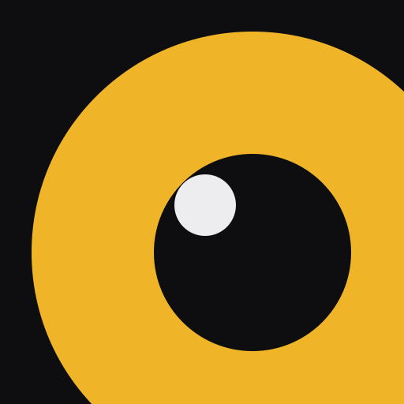

<p align="center">
  
</p>

<h1 align="center">Theasa</h1>

<p align="center">
  The server behind the Theasa tab of <a href="https://github.com/Kunba-Labs/sidra">Sidra</a> for iPad and iPhone.
</p>

Theasa records the Claude Code and Codex turns on your machines. A hook sends each finished turn to a small Bun server.
For each project you get a log of the turns: a summary, the decisions, the open items to check, and the tokens and time.
Each turn also shows an estimated cost at API list prices.
The server stores the turns in SQLite. The agent CLI that ran a turn also writes its summary.
Theasa has no web UI. You use the Theasa tab of the Sidra app on iPad and iPhone.
With herdr on the server machine, Sidra also shows the agents there that wait for an answer, and you can answer them.

## Requirements

- macOS or Linux
- [Bun](https://bun.sh) (tested with 1.4) and git
- Claude Code (`claude`) or Codex (`codex`), installed and logged in
- Optional: herdr, for live agents in Sidra

The server writes all summaries, also for turns from other machines.
Claude turns use `claude -p` with Haiku. Codex turns use `codex exec` with your default Codex model.
So the server machine needs the CLI of each agent you use.

## Install

```sh
git clone https://github.com/Kunba-Labs/theasa.git
cd theasa
bun theasa.ts install
```

`install` does three things:

- It makes a token in `~/.theasa/token` (mode 600). An existing token stays.
- It adds a Stop hook to `~/.claude/settings.json` and `~/.codex/hooks.json`. Your other hooks stay as they are.
- For Claude Code it also adds a hook on `AskUserQuestion`, so Sidra can show the question.

Theasa stores all its data in `~/.theasa/`. Only your user can read that folder.

## Run and check

```sh
bun theasa.ts serve
```

The server listens on `http://127.0.0.1:4747`. In a second terminal:

```sh
bun theasa.ts status
```

Now finish one short turn in Claude Code or Codex, and run `status` again. The turn count goes up by one.
The queue goes back to 0 when the summary is written.

If the server is down, the hook stores the turn in `~/.theasa/spool/`. The next hook run sends it.
To send it now, run `bun theasa.ts status --flush`. Claude Code and Codex stop the hook after 15 seconds at most.

## Reach it from your iPad or iPhone

Do not open port 4747 to your network or the internet. Your prompts, replies and agent screens are on this
server, and a token holder can send prompts to your agents. Use [Tailscale](https://tailscale.com) instead. Only your own devices can then reach the server.

Install Tailscale on the server and on the iPad or iPhone, and log in to the same tailnet on each.
Then use one of these two ways.

**With `tailscale serve` (recommended).** The server stays on `127.0.0.1`, and Tailscale publishes it at an HTTPS address on your tailnet:

```sh
tailscale serve --bg --https=4747 http://127.0.0.1:4747
tailscale serve status    # shows the address, like https://<machine>.<tailnet>.ts.net:4747
```

To stop sharing it, run `tailscale serve reset`.

**With the tailnet IP.** Bind the server to the machine's Tailscale address only:

```sh
THEASA_BIND=$(tailscale ip -4) bun theasa.ts serve
```

The address for Sidra is then `http://<that IP>:4747`. For the service, put the IP in `~/.theasa/config.json`
as `"bind"` (see [Configure](#configure)).

## Connect from Sidra

1. On the server, run `bun theasa.ts token` and copy the token.
2. In Sidra, open a new tab and pick **Theasa…**.
3. Type the address from the previous section. When Sidra runs on the same Mac, use `http://127.0.0.1:4747`.
4. Paste the token, tap **Test**, then **Save and open**.

Sidra stores the token in the Keychain.

## Run it as a service

Stop the server in the terminal first (Ctrl-C).

### macOS (launchd)

```sh
bun theasa.ts install --service
```

`install --service` adds the LaunchAgent `nl.theasa.server`. The server starts at login and starts again if it stops.
The log goes to `~/.theasa/server.log`.

The LaunchAgent gets only `PATH` and `THEASA_HOME` from your shell. Put the port and bind address in
`~/.theasa/config.json` (see [Configure](#configure)), then run `bun theasa.ts install --service` again to restart the server.

To remove the hooks and the service:

```sh
bun theasa.ts uninstall --service
```

### Linux (systemd)

Run `bun theasa.ts install` without `--service`. Then make a user unit:

```sh
mkdir -p ~/.config/systemd/user
$EDITOR ~/.config/systemd/user/theasa.service
```

Put this in it. Change the paths to where Bun and your clone are:

```ini
[Unit]
Description=Theasa
After=network-online.target

[Service]
ExecStart=%h/.bun/bin/bun %h/theasa/theasa.ts serve
Environment=PATH=%h/.local/bin:%h/.bun/bin:/usr/local/bin:/usr/bin:/bin
Restart=always

[Install]
WantedBy=default.target
```

With the `PATH` line, the server finds `claude` and `codex` for the summaries.
Put the port and bind address in `~/.theasa/config.json` (see [Configure](#configure)). Start the service:

```sh
systemctl --user daemon-reload
systemctl --user enable --now theasa
loginctl enable-linger "$USER"   # keep it running when you are not logged in
journalctl --user -u theasa -f   # the log
```

After a change to the unit, run `systemctl --user daemon-reload` and `systemctl --user restart theasa`.

## Import your history

The hooks record new turns only. To import the transcripts that are already on this machine, start the server and run:

```sh
bun theasa.ts backfill                         # all turns, stats only
bun theasa.ts backfill --summarize --since 1d  # all turns, and summaries for the last day
```

`--include-exec` also imports Codex `exec` sessions, which are skipped by default.
`--refresh` reads the diffs and attachments of stored turns again.

## More machines

One server can collect the turns of all your machines. On each extra machine:

1. Install Tailscale and log in to the same tailnet.
2. Clone this repo and `cd theasa`.
3. Copy the token from the server: `mkdir -p ~/.theasa`, put the token in `~/.theasa/token`, then `chmod 600 ~/.theasa/token`.
4. Run `bun theasa.ts install --server https://<machine>.<tailnet>.ts.net:4747`.
5. Run `bun theasa.ts status` to check the connection, and `bun theasa.ts backfill` to import the history of this machine.

Live agents in Sidra come only from the herdr on the server machine.

## Configure

| Setting | Default | How to change it |
| --- | --- | --- |
| Token | made by `install` | `bun theasa.ts token` prints it. Or set `THEASA_TOKEN` |
| Port | `4747` | `"port": 5000` in `~/.theasa/config.json`. The server, hooks and commands all use it |
| Bind address | `127.0.0.1` (this machine only) | `"bind": "100.64.0.1"` in `~/.theasa/config.json`, or `THEASA_BIND`. Read [Reach it from your iPad or iPhone](#reach-it-from-your-ipad-or-iphone) first |
| Server URL for hooks and commands | `http://127.0.0.1:<port>` | `install --server URL`, or `THEASA_SERVER` |
| Data folder | `~/.theasa` | `THEASA_HOME` |
| Agent CLIs for summaries | `claude`, `codex` on `PATH` | `THEASA_CLAUDE_BIN`, `THEASA_CODEX_BIN` |
| herdr binary | `herdr` on `PATH` | `THEASA_HERDR_BIN` |

`THEASA_PORT` changes only the port of the server. With it, set `THEASA_SERVER` for the hooks and commands too.

Every `/api` request needs the token as `Authorization: Bearer <token>`. Open endpoints, no token: `/`, `/health`,
the change stream `/api/events` (it sends only "change") and project icons.

For a Sidra connection without a token, set `THEASA_OPEN_READS=1`.
Live agent screens and attachments always need the token.

## All commands

```text
bun theasa.ts serve                         run the server and the summary worker
bun theasa.ts install [--server URL] [--service]
bun theasa.ts uninstall [--service]         remove only Theasa's hooks (and the service)
bun theasa.ts status [--flush]              server, hooks, spool; --flush sends the spooled turns
bun theasa.ts backfill [--summarize] [--since 7d] [--include-exec] [--refresh]
bun theasa.ts token                         print the token
bun theasa.ts deploy [--skip-tests]         macOS: run the service from a tested copy of the committed HEAD
bun theasa.ts rollback                      macOS: go back to the previous release
```

`deploy` copies the committed HEAD to `~/.theasa/releases/`, runs the tests there and points `~/.theasa/current`
at it. Then it restarts the service and waits for `/health` to report the new release. If the new release does
not start in 20 s, `deploy` starts the previous release again. Five releases stay on disk.

## Development

```sh
bun test
```

The product plan and the build spec are in `plans/`. A box in the spec gets its check mark only when its
acceptance test passes.

## License

[Apache-2.0](LICENSE). Copyright 2026 Kunba Labs.
